This is Mermaid code: renders automatically as a diagram wherever Mermaid is supported (e.g. GitHub, this Markdown viewer).

```mermaid
erDiagram
    PROFILES ||--o{ EVENTS : "organises (organiser_id)"
    PROFILES ||--o{ EVENTS : "coordinates (coordinator_id)"
    PROFILES ||--o{ EVENT_COORDINATOR_ASSIGNMENTS : "assigned as coordinator"
    EVENTS ||--o{ EVENT_COORDINATOR_ASSIGNMENTS : "assignment history"
    EVENTS ||--o{ VENUE_BOOKINGS : requests
    EVENTS ||--o{ VENUE_TENTATIVE_HOLDS : "temporarily reserves"
    VENUES ||--o{ VENUE_TENTATIVE_HOLDS : "held for"
    PROFILES ||--o{ VENUE_TENTATIVE_HOLDS : "created by"
    VENUE_BOOKINGS |o--o{ VENUE_TENTATIVE_HOLDS : "completes"
    VENUE_BOOKINGS |o--o{ VENUE_BLOCKS : "reservation source"
    VENUES ||--o{ VENUE_BOOKINGS : "booked for"
    PROFILES ||--o{ VENUE_BOOKINGS : "decided by (venue staff)"
    VENUES ||--o{ VENUE_EDIT_HISTORY : "has edit history"
    PROFILES ||--o{ VENUE_EDIT_HISTORY : "made changes"
    EVENTS ||--o{ EQUIPMENT_RESERVATIONS : requests
    EQUIPMENT ||--o{ EQUIPMENT_RESERVATIONS : "reserved for"
    PROFILES ||--o{ EQUIPMENT_RESERVATIONS : "decided by (tech support)"
    EVENTS ||--o{ REGISTRATIONS : accepts
    PROFILES ||--o{ REGISTRATIONS : "registers as attendee"
    EVENTS ||--o{ EVENT_CHANGE_REQUESTS : "amended via"
    PROFILES ||--o{ EVENT_CHANGE_REQUESTS : requests
    PROFILES ||--o{ EVENT_CHANGE_REQUESTS : "decided by (coordinator)"
    PROFILES ||--o{ NOTIFICATIONS : receives
    EVENTS ||--o{ NOTIFICATIONS : "relates to"

    PROFILES {
        uuid id PK
        text full_name
        text role "organiser, attendee, coordinator, venue_staff, tech_support"
        text contact_number "nullable, required for attendee + organiser at signup"
        text organization "nullable, required for organiser at signup"
        timestamptz created_at
    }

    EVENTS {
        uuid id PK
        uuid organiser_id FK "must reference a profile with role=organiser"
        uuid coordinator_id FK "must reference a profile with role=coordinator"
        text name
        text purpose
        text description
        timestamptz start_time
        timestamptz end_time
        int expected_attendance
        text layout_preference
        text accessibility_requirements
        text status "draft, under_review, rejected, planning, confirmed, completed, change_requested"
        text review_notes "coordinator's clarification/amendment request to the organiser"
        bool is_draft
        bool registration_enabled
        int registration_capacity
        timestamptz registration_deadline
        timestamptz created_at
        timestamptz completed_at "nullable; time of automatic completion"
    }

    EVENT_COORDINATOR_ASSIGNMENTS {
        uuid id PK
        uuid event_id FK
        uuid coordinator_id FK "must reference a profile with role=coordinator"
        timestamptz assigned_at
    }

    VENUES {
        uuid id PK
        text name
        text location
        int capacity
        jsonb facilities
        jsonb accessibility
        jsonb layouts
        jsonb operating_hours
        int setup_time_minutes "not null, default 0, nonnegative"
        int turnaround_time_minutes "not null, default 0, nonnegative"
    }

    VENUE_EDIT_HISTORY {
        uuid id PK
        uuid venue_id FK
        uuid changed_by FK
        timestamptz changed_at
        text[] changed_fields
        jsonb old_values
        jsonb new_values
    }

    VENUE_BOOKINGS {
        uuid id PK
        uuid event_id FK
        uuid venue_id FK
        text status "tentative, confirmed, rejected"
        text decision_reason
        uuid decided_by FK "must reference a profile with role=venue_staff"
        timestamptz decided_at
        timestamptz start_time
        timestamptz end_time
    }

    VENUE_TENTATIVE_HOLDS {
        uuid hold_id PK
        uuid venue_id FK
        uuid event_id FK
        uuid created_by FK
        timestamptz created_at
        timestamptz start_at
        timestamptz end_at
        timestamptz expires_at
        timestamptz released_at "nullable; active derived from expiry and release"
        uuid completed_booking_id FK "nullable"
        timestamptz expiry_claimed_at "notification retry lease"
        timestamptz expiry_notified_at
    }

    VENUE_BLOCKS {
        uuid block_id PK
        uuid venue_id FK
        uuid source_booking_id FK "nullable; populated for new booking reservations"
        text block_reason
        timestamptz start_at
        timestamptz end_at
        uuid block_issuer FK
    }

    EQUIPMENT {
        uuid id PK
        text name
        text type
        text maintenance_status
    }

    EQUIPMENT_RESERVATIONS {
        uuid id PK
        uuid event_id FK
        uuid equipment_id FK
        int quantity_requested
        text technical_requirements
        text status "requested, reserved, rejected"
        text decision_reason
        uuid decided_by FK "must reference a profile with role=tech_support"
        timestamptz decided_at
    }

    REGISTRATIONS {
        uuid id PK
        uuid event_id FK
        uuid attendee_id FK "must reference a profile with role=attendee; unique per event"
        text status "registered, withdrawn"
        timestamptz registered_at
    }

    EVENT_CHANGE_REQUESTS {
        uuid id PK
        uuid event_id FK
        uuid requested_by FK "must reference a profile with role=organiser"
        text change_type
        text details
        text status "pending, approved, rejected, expired"
        text decision_reason
        uuid decided_by FK "must reference a profile with role=coordinator"
        timestamptz requested_at
        timestamptz decided_at
    }

    NOTIFICATIONS {
        uuid id PK
        uuid user_id FK
        uuid event_id FK
        text type
        text title
        text body
        boolean is_read
        timestamptz created_at
    }
```

T7-266 adds `events.completed_at` through `database/event_completion.sql` and the
`expired` request status through `database/event_request_expiry.sql`. Cancellation requests use
`previous_event_status`; change requests use `event_status_before_request` to
preserve their original workflow states. Completion does not add or remove any
relationships.

Tentative holds are deployed with the additive `database/venue_tentative_holds.sql` script.
An active hold has no release time and `expires_at > now()`; expiry does not delete history or depend on a scheduler.
A same-event, same-venue approval covering the full held event period records its completion.
Booking occupancy uses current venue setup/turnaround as a minimum and retains any larger stored reservation.
Expiry notifications remain due after a late completion; the system runner leases and acknowledges delivery through the existing notification service.
New booking blocks carry `source_booking_id`. Uniquely fingerprinted older blocks are grouped with the booking without changing stored records;
the calendar retains their details and marks uncertain classification. Other blocks remain visible.
